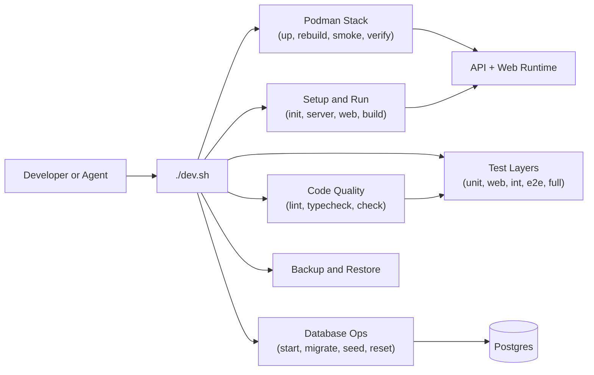
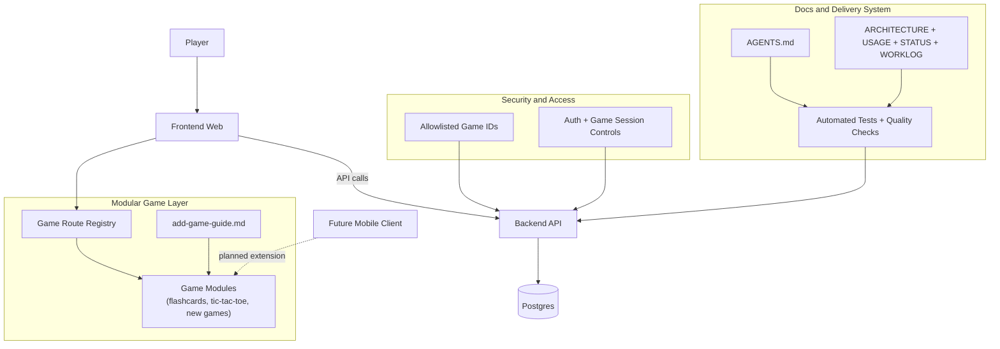
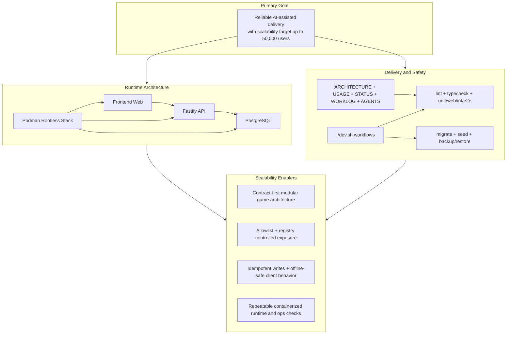

# KGP + Codex Presentation Brief (20 Minutes)

Created: 2026-03-29 23:58 EET
Audience: Internal developer team
Goal: Show how docs-first structure + automation + agent rules improved delivery speed and reliability.

## 1. Talk Structure and Timing

1. Why this setup matters (2 min)
2. Platform overview and architecture (3 min)
3. Docs-first operating model (4 min)
4. Dev setup: `dev.sh`, Podman, DB workflows (4 min)
5. Quality system: tests + verification (3 min)
6. Modularity and adding new games (3 min)
7. Close: productivity impact and takeaways (1 min)

## 2. Slide-by-Slide Sequence

### Slide 1 — Title and context (1 min)

Main points:
1. Kids Games Platform as a practical AI-assisted engineering case.
2. Objective: build fast without losing correctness.
3. Core thesis: docs + automation + tests are force multipliers for Codex and humans.

Speaker note:
- Frame the talk as an engineering process story, not just a demo of one game.

### Slide 2 — What we built (1 min)

Main points:
1. Monorepo with backend, web, shared packages, and game modules.
2. Current games: flashcards and tic-tac-toe.
3. Structured project docs and agent instructions as first-class assets.

Command example:
```bash
ls -la
```
Shows top-level repo structure and key roots (`project_docs`, `games`, `frontend`, `server`, `dev.sh`).

### Slide 3 — Architecture and runtime model (3 min)

Main points:
1. Single-server, localhost-first deployment model.
2. Rootless Podman stack for reproducible local environment.
3. Modular game integration model with allowlist and route registry.

Command examples:
```bash
./dev.sh stack:up
./dev.sh stack:ps
```
Starts the full stack and shows service status.

### Slide 4 — Docs-first system: what each file does (2 min)

Main points:
1. `ARCHITECTURE.md`: technical map and design intent.
2. `IMPLEMENTATION_STATUS.md`: evidence-backed maturity/status matrix.
3. `USAGE.md`: executable workflows and troubleshooting.
4. `WORKLOG_curr.md`: append-only change and verification history.
5. `history/` vs `ongoing/`: separation of archive vs active execution.

Command example:
```bash
rg -n "USAGE.md|IMPLEMENTATION_STATUS|WORKLOG_curr|ARCHITECTURE" README.md project_docs
```
Shows cross-links and discoverability.

### Slide 5 — AGENTS.md: how autonomous work stays safe (2 min)

Main points:
1. Minimal-context rules: read only what is needed.
2. Ownership-first workflow: feature file + nearest tests + immediate integration points.
3. Verification before and after changes.
4. New ambiguity policy:
   - main thread asks for high-impact clarifications,
   - delegated agents proceed with explicit assumptions.

Command example:
```bash
sed -n '1,120p' AGENTS.md
```
Highlights concrete operating rules for agents.

### Slide 6 — `dev.sh` as the developer control plane (2 min)

Main points:
1. One script for setup, run, test, DB, stack, and backup/restore.
2. Reduces onboarding friction and command drift.
3. Encodes safe, repeatable workflows.

Command examples:
```bash
./dev.sh help
./dev.sh init
```
`help` lists all targets; `init` bootstraps dependencies + DB baseline.

### Slide 7 — Database and container workflows (2 min)

Main points:
1. Local DB lifecycle is scripted and repeatable.
2. Stack includes migration, seed, smoke checks.
3. Backup/restore included for operational confidence.

Command examples:
```bash
./dev.sh db:start
./dev.sh db:migrate
./dev.sh db:seed
./dev.sh stack:smoke
```
Brings DB up, applies schema/data, verifies stack health.

### Slide 8 — Quality gates and automated tests (3 min)

Main points:
1. Layered test strategy: unit, web, integration, e2e, full.
2. Baseline-before-change and re-verify-after-change discipline.
3. Better confidence for AI-generated changes.

Command examples:
```bash
./dev.sh test:unit
./dev.sh test:web
./dev.sh test:int
./dev.sh test:e2e
./dev.sh test:full
```
Covers progressively broader validation scopes.

### Slide 9 — Adding games with confidence (2 min)

Main points:
1. `docs/add-game-guide.md` is the canonical game integration contract.
2. Required module shape + manifest/registry/allowlist rules are explicit.
3. Enables predictable autonomous implementation for new games.

Command examples:
```bash
pnpm games:conformance
pnpm boundary:check
```
Checks module structure and architecture boundaries.

### Slide 10 — Outcomes and reusable pattern (2 min)

Main points:
1. Faster iteration with lower regression risk.
2. Better handoff quality across humans and agents.
3. Traceable progress through status + worklog + trackers.
4. Reusable blueprint for other projects using Codex/AI tools.

Speaker note:
- Close with: “Speed came from automation; safety came from docs and tests; scale came from clear agent contracts.”

## 3. Key Narrative to Emphasize

1. We did not use AI as a replacement for process.
2. We used AI inside a strong process: clear docs, strict rules, and automated verification.
3. The result is higher production throughput with controlled risk.

## 4. Optional Demo Flow (if time allows)

1. `./dev.sh help` (show command surface)
2. `./dev.sh test:web` (show fast confidence loop)
3. Open `docs/add-game-guide.md` (show extensibility contract)
4. Open `AGENTS.md` (show autonomous safety model)

## 5. Q&A Backup Points

1. Why docs-first helps AI:
- it reduces prompt ambiguity and context bloat.
2. Why test automation matters:
- it converts generated code into verified outcomes.
3. Why one orchestrator script matters:
- it standardizes execution across contributors and agents.

## Addendum — Mermaid Diagrams

Appended: 2026-03-30 00:05 EET

### Diagram 1 — Developer Workflow Overview



### Diagram 2 — Platform Architecture Overview



## Addendum — Architecture Rationale Notes (for speaking)

Appended: 2026-03-30 00:18 EET

1. **Why PostgreSQL was chosen**
- Strong transactional guarantees and mature schema tooling make it reliable for auth, game metadata, points, and progress.
- Migration and seed flows are built into daily work (`db:migrate`, `db:seed`), with idempotent seed behavior for safer repeats.

2. **Why Podman containerization matters**
- Rootless Podman provides reproducible local/runtime behavior without Docker-daemon coupling.
- The project has explicit stack lifecycle commands (`stack:up`, `stack:rebuild`, `stack:smoke`, `stack:verify`) that improve release confidence.

3. **Basic deployment readiness signals**
- Full stack orchestration exists, including reverse-proxy path, migration/seed jobs, and smoke checks.
- Backup/restore commands are first-class, which is a strong operational maturity indicator even at MVP stage.

4. **Sanity checks before and after changes**
- The engineering workflow emphasizes baseline validation before edits and re-validation after edits.
- Layered test coverage (unit/web/integration/e2e) helps keep AI-assisted changes safe and regressions visible early.

5. **Data persistence and user continuity**
- The architecture supports durable user/session/progress state in DB and resilient client behavior for offline/retry scenarios.
- Idempotent write strategy reduces duplicate-write risk during retries and reconnects.

6. **Scalability and extensibility posture**
- The system scales by contract-first modularity: game manifests, registry wiring, adapter shape, allowlist control.
- Today’s model favors explicit integration over implicit discovery, trading some convenience for predictable safety.

7. **Honest capability framing**
- Core platform reliability is strong (automated checks, repeatable environment, evidence-backed status docs).
- Deferred areas (for example full mobile runtime and some server-authoritative gameplay aspects) are explicitly tracked rather than hidden.

## Addendum — Architecture Rationale Diagram (one-screen)

Appended: 2026-03-30 00:24 EET


